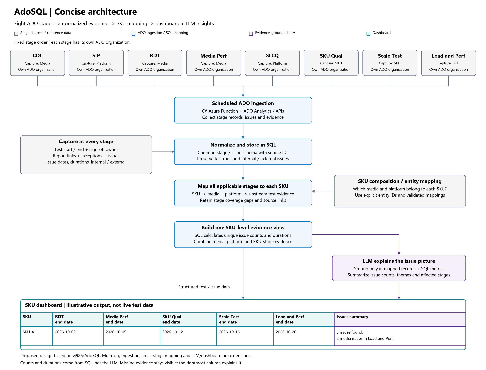
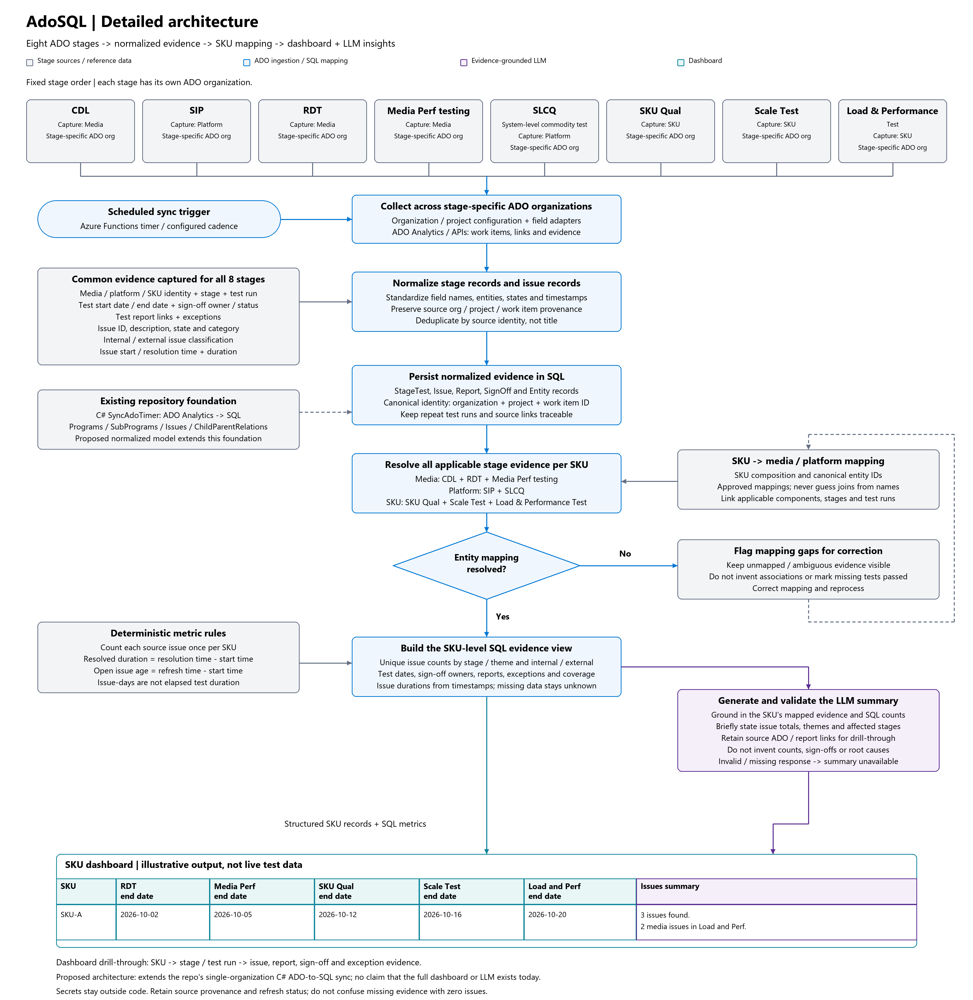

# TimerTrigger - C#

The `TimerTrigger` makes it incredibly easy to have your functions executed on a schedule. This sample demonstrates a simple use case of calling your function every 5 minutes.

## How it works

For a `TimerTrigger` to work, you provide a schedule in the form of a [cron expression](https://en.wikipedia.org/wiki/Cron#CRON_expression)(See the link for full details). A cron expression is a string with 6 separate expressions which represent a given schedule via patterns. The pattern we use to represent every 5 minutes is `0 */5 * * * *`. This, in plain text, means: "When seconds is equal to 0, minutes is divisible by 5, for any hour, day of the month, month, day of the week, or year".

## Architecture diagrams

The diagrams describe the proposed end-to-end architecture, extending this repository's C# Azure Function and ADO-to-SQL sync with multi-organization ingestion, SKU mapping, a dashboard, and evidence-grounded LLM summaries.

Stage order: **CDL -> SIP -> RDT -> Media Perf -> SLCQ -> SKU Qual -> Scale Test -> Load and Perf**. Each stage has its own ADO organization.

### Concise version

Stage data is normalized in SQL and linked to each SKU through its media and platform. The final dashboard table shows SKU, the RDT, Media Perf, SKU Qual, Scale Test, and Load and Perf end dates, followed by Issues summary. A sample summary is: "3 issues found. 2 media issues in Load and Perf."

[Full-size PNG](docs/architecture/adosql-concise.png) | [SVG](docs/architecture/adosql-concise.svg) | [Editable Excalidraw](docs/architecture/adosql-concise.excalidraw)

### Detailed version

Shows stage-specific entity capture, test dates, sign-off owners, report links, exceptions, internal/external issues, issue durations, normalization, mapping validation, and source-linked LLM summaries. SQL computes counts and durations; the LLM explains the evidence rather than inventing metrics. Dashboard rows are illustrative, not live test data.

[Full-size PNG](docs/architecture/adosql-detailed.png) | [SVG](docs/architecture/adosql-detailed.svg) | [Editable Excalidraw](docs/architecture/adosql-detailed.excalidraw)

## Learn more

<TODO> Documentation